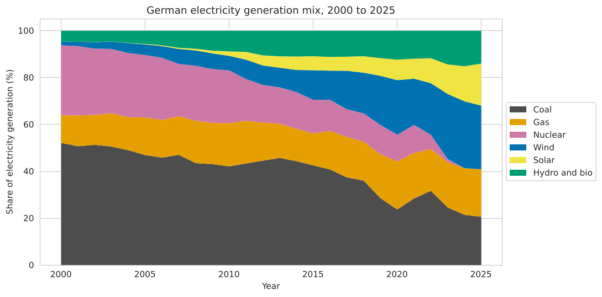
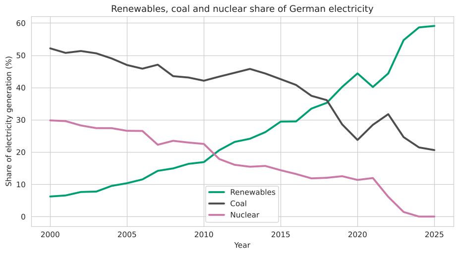
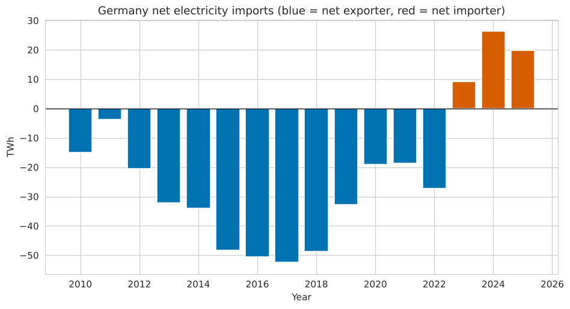
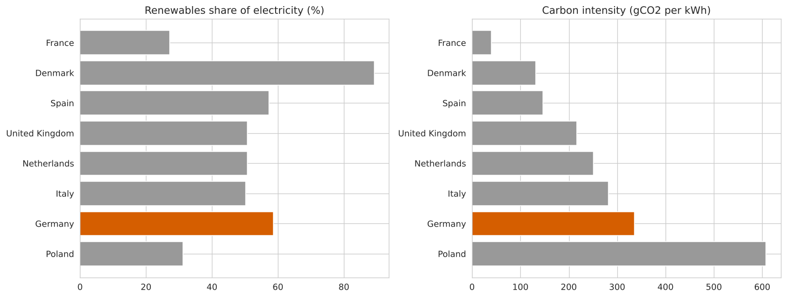

# Germany's Electricity Transition


### Exploratory Data Analysis of the German Electricity Mix, 2000 to 2025
**Author:** [@pardisHpa](https://github.com/pardisHpa)

---

## Project Overview

This project analyses how Germany's electricity generation changed between
2000 and 2025: which sources grew, which declined, what it did to carbon
intensity, and how Germany compares with seven other European countries.

The goal is to turn annual energy data into clear, business-relevant
insights, the kind of questions an analyst at an energy company or a
grid operator might be asked.



---

## Dataset

| Property | Details |
|---|---|
| Source | [Our World in Data, Energy dataset](https://github.com/owid/energy-data) (CC BY 4.0) |
| Underlying sources | Ember and the Energy Institute Statistical Review, compiled by Our World in Data |
| Rows | 208 (8 countries x 26 years) |
| Period | 2000 to 2025 |
| Countries | Germany, France, Denmark, Poland, Spain, United Kingdom, Italy, Netherlands |
| Key Columns | electricity_generation, share of each source (coal, gas, nuclear, wind, solar, hydro, ...), renewables_share_elec, carbon_intensity_elec, net_elec_imports |

The latest year can be revised by the data provider later.

---

## Tools & Libraries

- Python 3
- Pandas
- Matplotlib
- Seaborn
- NumPy
- Jupyter Notebook

---

## Project Structure

```
energy-transition-eda/
│
├── Germany_Electricity_Transition_EDA.ipynb   # Main analysis notebook
├── prepare_data.py                            # Downloads and filters the raw data
├── README.md                                  # Project documentation
├── requirements.txt
├── data/
│   └── owid_energy_selected.csv               # Filtered dataset used in the notebook
└── images/                                    # Charts used in this README
```

---

## Analysis Summary

### 1. Data Quality
No duplicate country-year rows. The only missing values are 6 entries for
"other renewables" for the United Kingdom (2020 to 2025), which are not
used in the analysis. For every row the generation shares add up to 100%.

---

### 2. Electricity Mix
Germany's mix changed completely in 25 years. Renewables grew from 6.2% to
59.1% of generation, coal fell from 52.1% to 20.6%, and nuclear fell from
29.8% to 0%.

| Source | 2000 | 2010 | 2020 | 2025 |
|---|---|---|---|---|
| Coal | 52.1% | 42.1% | 23.7% | 20.6% |
| Gas and oil | 11.8% | 18.5% | 20.5% | 20.3% |
| Nuclear | 29.8% | 22.5% | 11.4% | 0.0% |
| Wind | 1.6% | 6.2% | 23.3% | 27.2% |
| Solar | 0.0% | 1.9% | 8.7% | 17.9% |
| Hydro and bio | 4.6% | 8.8% | 12.3% | 14.0% |

---

### 3. Renewables Overtake Coal
Renewables produced more electricity than coal for the first time in
**2019** (40.2% vs 28.6%).



---

### 4. Wind and Solar
Wind and solar together grew from 1.6% (2000) to 8.1% (2010), 32.0% (2020)
and 45.1% (2025). They are now the largest source of German electricity.

---

### 5. Carbon Intensity
Carbon intensity fell by 42%, from 573 to 330 gCO2 per kWh. The coal share
and carbon intensity move almost together (correlation 0.996), which is
expected because coal is the most carbon-intensive source.

---

### 6. Nuclear Phase-Out and Electricity Trade
Germany was a net exporter of electricity in every year from 2003 to 2022.
In 2023, the year the last reactors went offline, it became a net importer,
and it has stayed one since.

| Year | Net imports (TWh) |
|---|---|
| 2015 | -48.3 (net exporter) |
| 2022 | -27.3 (net exporter) |
| 2023 | +9.2 (net importer) |
| 2024 | +26.3 (net importer) |
| 2025 | +19.8 (net importer) |



The timing matches the phase-out, but the data alone does not prove the cause.

---

### 7. Crisis Years
During the energy crisis, the coal share rose from 23.7% (2020) to 28.4%
(2021) and 31.7% (2022), and carbon intensity rose from 356 to 420 gCO2 per
kWh. In 2022 the nuclear share dropped from 11.9% to 6.1%.

---

### 8. Demand
Electricity generation peaked at 644 TWh in 2017 and was 500 TWh in 2025,
22% below the peak.

---

### 9. Germany vs. Seven European Countries (2024)
Germany has the second-highest renewables share of the eight countries
(58.6%, after Denmark with 89.2%), but only Poland has a higher carbon
intensity. Germany still has 21.4% coal in its mix.

| Country | Renewables | Coal | Carbon intensity (gCO2/kWh) |
|---|---|---|---|
| France | 27.2% | 0.2% | 40.5 |
| Denmark | 89.2% | 5.0% | 131.8 |
| Spain | 57.3% | 0.9% | 146.2 |
| United Kingdom | 50.6% | 0.7% | 216.5 |
| Netherlands | 50.7% | 6.1% | 250.7 |
| Italy | 50.2% | 1.5% | 281.4 |
| **Germany** | **58.6%** | **21.4%** | **336.4** |
| Poland | 31.1% | 54.3% | 608.2 |



---

## Key Insights

1. **The transition was fast.** Renewables went from 6% to 59% of generation
   in 25 years, and wind and solar alone supply 45%.

2. **Coal is what keeps carbon intensity high.** Germany has one of the
   highest renewables shares of the group, yet it is behind six of the
   seven countries on carbon intensity, because coal is still 21% of the mix.

3. **A high renewables share does not guarantee low carbon.** France has a
   low renewables share (27%) but very low carbon intensity (40.5 gCO2/kWh)
   thanks to nuclear power. What matters is the share of fossil fuels.

4. **Germany changed from net exporter to net importer** in 2023 (it had
   exported in every year from 2003 to 2022) and has stayed one since, while its own generation is 22% below the 2017 peak.

5. **Security of supply and decarbonisation can conflict.** In 2021 and 2022
   the coal share went up, so progress was not a straight line.

6. **For a grid or energy company, the question changes.** With 45% of
   electricity coming from wind and solar, flexibility, storage and
   network capacity become central. This last point is my interpretation,
   not a result from the data.

---

## Limitations

- The data is annual. It shows the long-term trend, not hourly or daily
  patterns, prices, or grid constraints.
- It covers electricity generation, not total energy use.
- A natural next step is hourly generation and price data (for example from
  the Bundesnetzagentur's SMARD portal) to study how wind and solar affect prices.

---

## How to Run

```bash
# Clone the repository
git clone https://github.com/pardisHpa/energy-transition-eda.git

# Navigate to the project folder
cd energy-transition-eda

# Install the libraries
pip install -r requirements.txt

# Launch Jupyter Notebook
jupyter notebook Germany_Electricity_Transition_EDA.ipynb
```

To download the data again, run `python prepare_data.py`.

---

## Author

**pardisHpa**
Aspiring Junior Data Analyst | Background in Business & Systems Analysis
Master's in Data Analytics & Information Systems Management, Arden University Berlin

[GitHub](https://github.com/pardisHpa)

---

*Data source: Our World in Data energy dataset (CC BY 4.0)*
